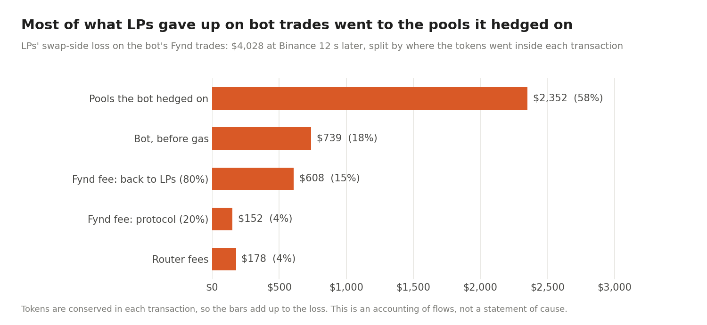

# Fynd ETH/USDG: bot economics and where the LPs' value went

Fynd ETH/USDG pool on Robinhood Chain (Ekubo Core, Fynd extension `0x550cfe12…1d09`). Bot trades rebuilt from chain
data: 24,199 of 24,258 bot transactions (2026-10-13 11:47 to 2026-11-13 06:35 UTC).
LP figures: every position from Oct 2 to the Nov 13 snapshot (checked Nov 13 report, unchanged).

Evidence labels used below: **observed** (read directly from chain logs), **calculated** (arithmetic on observed data),
**inferred** (rebuilt from behaviour or indirect records), **assumed** (needed because data is missing), **not measurable**.

## The short answer

- **LPs lost $3,925 against holding** over 42 days: fees +$2,069, impermanent loss
  −$5,993. On an average $18,500 of capital that is 21.2% lost over the period, 15.1% per 30 days. *Calculated.*
- **The bot made $295 net** on its Fynd ETH/USDG trades (+$739 gross, −$443 gas). Every one of its
  24,199 complete transactions is an atomic round trip: it trades Fynd and closes the position on other on-chain
  pools in the same transaction, keeping a small profit and no inventory. *Calculated from observed logs; native-ETH legs
  inferred and confirmed against the bot's own event in every transaction.*
- **The bot did not take most of what LPs lost on its trades.** On the bot's swaps, LPs' swap side was −$4,028 at Binance
  12 s later. Inside the same transactions that value went to:
  the pools the bot hedged on, +$2,352 (58%);
  the bot, +$739 (18%);
  the Fynd fee, +$760 (19%; 80% back to LPs, 20% to the protocol);
  router fees, +$178 (4%).
  *Calculated; tokens are conserved inside each transaction, so the parts add up exactly.*
- **The bot moves the pool toward the market in 97.9% of its trades, but usually stops short.**
  It trades when Fynd is about 7.7 bp off Binance and leaves it about 5.0 bp off: that is where
  Fynd's price meets the other pools' prices after their costs. *Calculated.*
- **Why LPs still lose:** every rebalance sells LP inventory at a price that is several bp stale, and the bot pays a fee of
  only 1.7 bp on it (other traders pay 19.8 bp). Most of the gap is paid to the hedge pools, not kept by
  the bot. The bot was also idle for more than an hour 32 times (136 of 739 hours), when the pool drifted far from the market.

## 1. Who is who

| Address | Role | Evidence |
|---|---|---|
| `0x4abfdbac…84a2` | bot EOA (sends the trades) | confirmed by the user (Nov 11); observed: sent all 24,258 bot Fynd swaps; nonce 0 = its first Fynd trade (block 87,487,456); registered in the bot contract at deployment (event 0xd58299b7, block 84,286,819); pays all gas |
| `0x7ea0ab3b…acc7` | bot contract (executes trades, holds profits) | observed: target of every bot tx; emits one trade event per trade (42,405 all-time, 4 Ekubo pools); receives the Fynd leg and keeps the profit |
| `0xd7c8c4eb…1c80` | bot contract owner until block 111,842,342 | observed: OwnershipTransferred at deployment, then a two-step transfer away |
| `0x0d41d284…d4b2` | bot contract owner from block 111,842,342 | observed: OwnershipTransferStarted + OwnershipTransferred |
| `0x09215a47…ff9e` | router used by the bot for the hedge legs | observed: receives and forwards every hedge leg; emits (recipient, amount) fee events; unwraps WETH |
| `0xa5503d92…4a14` | router fee recipient | observed (role); owner not known: named in router fee events; total charged to the bot $177.57 on Fynd trades |
| `0x550cfe12…1d09` | Fynd extension on the ETH/USDG pool | observed: charges the dynamic fee; pays LPs 80% via FeesAccumulated; its event carries share = 0.2 |
| `0x4f2826f9…0312` | address inside the Fynd extension's event | observed; role not known: constant in every extension event; possibly a signer or fee recipient (not verified) |
| `0x00000000…d701` | Ekubo Core (holds the pool) | observed: swap and fee logs; native ETH settles here |
| `0x8366a39c…0951` | Uniswap v4 PoolManager | observed: most hedge legs (pools 0x84bd4e2d WETH/USDG 0.02%, 0x24107d15 ETH/USDG 0.01%) |
| `0x6c6a40d2…7127` | largest LP of the Fynd pool (EIP-7702 delegated EOA) | observed; the brief calls it the bot, the data does not support that: 305 position events, 11 swaps (multi-pool routes sent to itself); code = 0xef0100 + 0x000000005c84f8fd50b21cac312528a64437030e; never sends bot trades |

**The brief says `0x6c6a40d2…7127` is Fynd's bot. The chain data does not support that.** That wallet made position
changes as the pool's largest LP and sent a handful of multi-pool swaps; it never sent a bot trade. Every bot trade comes
from `0x4abf…84a2` through contract `0x7ea0…acc7`. If Fynd confirmed `0x6c6a` as *its own LP wallet*, Fynd is on
both sides of most bot trades, and much of the LP loss is a transfer between two Fynd wallets. Not verified: wallet
ownership is not inferred from behaviour here.

## 2. How one bot trade works

Example: `0x21baf60f…63da`, the bot EOA's first trade (nonce 0), Oct 13 11:47:37 UTC. Full hand check in
`hand_checks/HAND_CHECKS.md`.

1. The bot contract takes a flash position on Ekubo Core: Fynd receives 0.193039 ETH and pays 484.198495 USDG (observed).
2. The USDG goes, through router `0x0921…ff9e`, into a Uniswap v4 WETH/USDG pool, which pays 0.193187 WETH (observed).
3. The router unwraps the WETH and the contract pays Ekubo 0.193171 ETH: the swap amount plus a Fynd fee of 0.000132 ETH
   (inferred: native ETH leaves no log; the amount is in the bot contract's own event and matches the 80% that reaches LPs).
4. The bot keeps 0.0000160 ETH ($0.040), pays $0.019 of gas, nets $0.021 (calculated).
5. At Binance at execution, Fynd's LPs gave up $1.04 on the swap, got back $0.26 of fee (the protocol $0.07), the v4 pool
   gained $0.67, the bot $0.04.

**The Fynd fee.** The extension charges a dynamic fee on top of the swap (bot trades: volume-weighted 1.70 bp, median
0.50 bp, zero on 23% of trades). LPs receive 80% of it at the pool's next interaction (FeesAccumulated);
20% stays with the protocol. Verified: in 18,396 of 18,412 fee payments that cover only bot swaps,
the payment equals exactly 80% of the bot fees. *Observed for USDG-paid fees, inferred for ETH-paid fees.* The checked LP
reports count only the LPs' 80%; the protocol's 20% over the whole period is about $521.

## 3. Data, coverage and method

- **Transactions.** Every bot Fynd swap in the checked swap files (to block 113,153,559), fetched as receipts from the
  public RPC. Complete: 24,199; incomplete: 59 (listed with reasons in `bot_transaction_economics.csv`).
  The incomplete ones each have a hedge leg on a DEX type not decoded; their bot result still matches the bot's own event.
  Reconstruction equals the bot contract's own profit figure in 24,258 transactions. Value is conserved in every
  complete transaction to within $1.7e-13.
- **Legs decoded.** Ekubo swaps (Fynd and other pools), Uniswap v2, v3 and v4 swaps, ERC20 transfers, WETH wrap/unwrap,
  the router's fee events, the bot contract's trade event. *Observed.* Native ETH is *inferred* (no traces on this RPC).
- **Prices.** Binance ETHUSDC 1 s close; price "at T" = close of the candle opening at T−2, markout at T+h. USDG = $1
  (*assumed*). On-chain reference: Uniswap v3 WETH/USDG 0.01% mid before the transaction. On this chain that pool
  sits a median 2.6 bp below Binance with no lag (a basis, not a delay), so values at Binance carry that basis; section 4
  repeats the split at the on-chain price.
- **Bot costs outside these swaps.** The bot EOA's nonce counts every transaction it ever sent. Its last Fynd trade has
  nonce 36,023, so it had sent 36,024 transactions: 24,258 Fynd trades, about
  10,922 trades on the bot's three other Ekubo pools (10,922 in the bot contract's events; 100% of a
  random sample of 1,000 were sent by this EOA), and **844 others**: reverted attempts or other activity.
  Those cannot be listed on this RPC (*not measurable* individually; an indexer would list them).
  Estimated gas on them: −$13 (*assumed*: count x the median gas of a successful trade; reverts may use more or less).

## 4. Where the LPs' value went on the bot's trades

All 24,199 complete bot transactions. Positive = that party gained. Each row is a sum of a column in
`bot_transaction_economics.csv`.

| | at Binance, execution | at Binance, 12 s later | at the on-chain price |
|---|---|---|---|
| Fynd LPs, swap side (fee excluded) | −$3,552 | −$4,028 | −$3,817 |
| Fynd fee paid by the bot | +$760 | +$760 | +$743 |
| Router fee paid by the bot | +$178 | +$178 | +$170 |
| Bot, gross | +$739 | +$739 | +$725 |
| Pools the bot hedged on (their LPs and protocols) | +$1,876 | +$2,352 | +$2,180 |
| **Sum** | ≈ $0 | ≈ $0 | ≈ $0 |

The on-chain column covers the trades before Nov 13 (the on-chain reference data ends Nov 12 23:59). *Calculated.*
Read it as an accounting of tokens inside each transaction, not as cause: the hedge pools did not "take"
anything; they traded at their own prices, which happened to be closer to Binance than Fynd's.

What overlaps and what does not:
- This table covers only the bot's swaps. The LP figures (−$3,925) are position-level and cover all swaps plus later price
  moves; the LPs' swap-side loss on bot swaps (−$4,037 at 12 s, checked report) is one input to them, not an addition.
- The Fynd fee here is exact per swap. The checked LP split assigns fees to swaps proportionally, giving the bot's swaps
  $615 of LP fees; the exact LP share of the bot's fees is $608. Total LP fees do not change.
- The bot's profit is not "value extracted from LPs": 18% of the LPs' swap-side loss on its trades.
- External traders (not the bot) paid $1,838 of fees on $929,209 and came out +$36 against
  Binance 12 s later: roughly break-even. *Calculated.*

## 5. The bot's own economics (Fynd ETH/USDG only)

| | USD | Evidence |
|---|---|---|
| Gross trading P&L (after router fees, Binance at execution) | +$739 | calculated |
| Gas on these trades | −$443 | observed |
| **Net realized** | **+$295** | calculated |
| Unrealized: ETH profits revalued to the snapshot (ETH $1,936) | −$65 | calculated |
| Residual inventory left after a trade | $0 | observed |
| The 59 incomplete transactions, net (bot event confirmed, not in the rows above) | $0.08 | calculated |
| Gas on the EOA's other transactions (estimate) | −$13 | assumed |

Gross is positive on every trade (0 negative); 792 trades lose money after gas. The bot's typical edge is
about 1.6 bp of notional. The bot contract also trades three other Ekubo pools (tokenized stocks); those are
outside this study and reported only from the bot's own events in `summary.json`.

## 6. Execution quality and price alignment

- Moves the pool toward Binance: 97.91% of trades; overshoots past Binance: 5.73%. *Calculated.*
- Gap before a trade (median |gap|): 8.0 bp; after: 5.1 bp. Median price move per trade 2.7 bp,
  3% of the ETH it takes to move the pool 1%.
- Hedge price against Binance: buying ETH back +3.3 bp, selling it −4.2 bp. The hedge costs about
  3.9 bp; add the Fynd fee and the router fee (0.4 bp) and the bot's break-even is 4.8 bp with the median
  Fynd fee (0.5 bp) or 6.0 bp with the volume-weighted one (1.7 bp). It stops at 5.1 bp, between the two. That
  fits a bot that trades until its marginal profit against on-chain pools runs out (*inferred* from the match).
- Trades with a gap under 3 bp: 1,494. Trades where Binance had already moved ≥1 bp toward the pool in the
  previous 5 s: 1,131 (the gap was closing on its own).
- LPs' markout on the bot's trades (12 s is the headline):

| horizon | 1 s | 5 s | 12 s | 30 s | 60 s | 5 min |
|---|---|---|---|---|---|---|
| USD | −$3,950 | −$4,012 | −$4,028 | −$4,075 | −$4,024 | −$3,721 |
| bp of volume | −8.8 | −9.0 | −9.0 | −9.1 | −9.0 | −8.3 |

  Almost all of it is there at 1 s: the loss is the gap at execution, not a later move against LPs.
- Over time (every second of the bot's active period): median |gap| 4.6 bp, 23% of the time above 8 bp.
  When the gap is wide (>25 bp, 8% of the time) the bot almost never trades: these are its idle stretches.
- External traders who arrive more than an hour after the last bot trade face a median gap of
  31 bp, against about 5 bp within 5 minutes of one. LPs' net on those late trades: −8.2 bp. *Calculated.*

## 7. LP figures, reconciled

The Nov 13 report's −$3,925 is the sum of every position's (LP value − hold value): fees +$2,069 plus impermanent loss
−$5,993. Each position is valued at Binance at its own end (last withdrawal) or at the snapshot if still open
(6 positions, read on chain at block 113,153,559). Withdrawals mid-life are held to the position's end in the hold leg.
Capital-weighted: $18,500 average capital over 42.02 days = −21.2% over the period, scaled to
30 days −15.15% (fees +7.98%, IL −23.13%). The Nov 11 figure (19.8% over 40 days, 14.8% per 30 days)
used fewer days and is consistent. The Nov 5 markout report measured swap-level markout, not position returns; the two are
not added.

## 8. The Uniswap comparison, audited

`compare_pools.py` compares, over 2026-10-07 to 2026-11-12, each pool's LP loss with the theoretical LVR for the depth it had.

| | Fynd | Uniswap v3 WETH/USDG 0.01% |
|---|---|---|
| LP loss / theoretical LVR | 0.63 | 0.96 |
| Fees to LPs / theoretical LVR | 0.22 | 0.70 |
| Net / theoretical LVR | −0.41 | −0.26 |

What holds up:
- Same days, same Binance 1 s reference, same 12 s markout, same LVR formula (1-minute returns), the same depth
  normalisation. The fee comparison was wrong in the first version (the Uniswap pool's protocol keeps 1/4 of its fee, so its
  LPs earn 0.75 bp, not 1 bp); this table is the corrected one.
- Liquidity between swaps: adding back Uniswap's 17,384 deposits and withdrawals between swaps (2026-10-22 to 2026-11-12) changes its
  theoretical LVR by −0.03%; loss/LVR stays 0.954 (was 0.954 on those days). Fynd's was checked the same way
  earlier (within 1%).

What is not like for like:
- Flow: 93% of Fynd's volume is its own bot. Median trade $155 on Fynd vs $296 on Uniswap;
  837 vs 179,587 swaps a day.
- Fees: Fynd LPs get 4.0 bp of volume, Uniswap LPs 0.75 bp; Fynd's bot pays far less than other Fynd traders.
- Uniswap's depth is set by many LPs competing; Fynd's by a few. LP-level returns against holding were not computed for Uniswap.

The result is not stable over time:

| | days | Fynd loss/LVR | Uniswap loss/LVR | Fynd net/LVR | Uniswap net/LVR |
|---|---|---|---|---|---|
| before 2026-10-22 | 15 | 0.48 | 0.96 | −0.26 | −0.31 |
| from 2026-10-22 | 21 | 0.88 | 0.95 | −0.65 | −0.20 |

In the first two weeks Fynd's LPs lost half as much per unit of LVR and did slightly better net than Uniswap's; from Oct 22
their loss share was close to Uniswap's and their net much worse. The full-window figure is an average of two different regimes.

What can be said: per unit of theoretical LVR, Fynd's LPs lost less than Uniswap's to the trades against them
(loss/LVR 0.63 vs 0.96). Fees covered much less of it (net/LVR −0.41 vs −0.26), so Fynd's LPs did worse net.
The lower loss share fits a bot that keeps the pool within about 5–8 bp of the market; the weaker fee cover fits a bot that pays
1.7 bp.

## 9. Policy replays

`policy_sim.py` replays the pool second by second from the bot's first to last trade: real Binance prices, every real
deposit and withdrawal (the pool engine reproduces all 28,100 real swaps to within 0.77 bp), every external swap with its real
ETH amount and fee rate, and a bot that hedges at Binance ± 3.9 bp, pays the Fynd fee, router fee and gas, and is
idle when the real bot was idle (up 82% of the time). Policy A is the profit-maximising rule above, with its minimum
profit fitted to the real trade count (fit: $0.00, i.e. any trade with positive expected profit).

**Calibration.** A makes 23,657 trades (real 24,258); LPs' trading-side net at 12 s −$3,442 (real
−$3,553). The split differs: LP markout on bot trades −$4,408 (real −$4,037), on external swaps
−$513 (real −$1,003): the simulated pool is better aligned than the real one was, so external traders find fewer
stale prices and the bot more. The model's bot earns more than the real one (gross +$1,236 vs +$739), because its hedge cost does not grow with size: read bot results as
upper bounds and compare policies with each other, not with reality.

| policy | what changes | bot trades | LP net, trading side 12 s | LP fees | protocol fees | bot net | mean gap to Binance (bp) | time >10 bp off |
|---|---|---|---|---|---|---|---|---|
| REAL | what happened (same window, same measures) | 24,258 | −$3,553 | $1,487 | $372 | +$295 | 9.1 | 18% |
| A | existing policy, reconstructed | 23,657 | −$3,442 | $1,479 | $370 | +$803 | 9.2 | 15% |
| A0 | A with the bot always on (no >1 h pauses) | 27,636 | −$3,685 | $1,572 | $393 | +$1,160 | 5.6 | 7% |
| B8 | A + minimum gap 8 bp before trading | 23,261 | −$3,446 | $1,477 | $369 | +$822 | 9.2 | 15% |
| B10 | A + minimum gap 10 bp before trading | 15,834 | −$3,511 | $1,438 | $360 | +$1,217 | 9.0 | 15% |
| B15 | A + minimum gap 15 bp before trading | 6,792 | −$3,608 | $1,275 | $319 | +$1,927 | 10.7 | 26% |
| C0.05 | minimum expected net profit $0.05 after fees and gas | 12,413 | −$3,605 | $1,422 | $355 | +$1,451 | 9.5 | 19% |
| C0.25 | minimum expected net profit $0.25 after fees and gas | 5,479 | −$3,789 | $1,289 | $322 | +$2,153 | 12.1 | 31% |
| C1.0 | minimum expected net profit $1.0 after fees and gas | 2,133 | −$4,045 | $1,155 | $289 | +$2,915 | 17.3 | 48% |
| D0 | Fynd fee on bot trades 0 bp (bot re-optimises) | 30,326 | −$4,156 | $809 | $202 | +$946 | 8.3 | 14% |
| D3 | Fynd fee on bot trades 3 bp (bot re-optimises) | 20,264 | −$3,088 | $1,837 | $459 | +$721 | 9.7 | 16% |
| D5 | Fynd fee on bot trades 5 bp (bot re-optimises) | 16,418 | −$2,702 | $2,221 | $555 | +$634 | 10.5 | 22% |
| D10 | Fynd fee on bot trades 10 bp (bot re-optimises) | 10,917 | −$2,105 | $2,734 | $684 | +$486 | 12.8 | 41% |
| D19.8 | Fynd fee on bot trades 19.8 bp (bot re-optimises) = what other traders pay: a one-fee passive pool | 6,335 | −$1,647 | $3,165 | $791 | +$389 | 16.8 | 60% |
| E1 | A + max price move 1 bp per trade | 61,147 | −$4,049 | $1,309 | $327 | +$1,271 | 17.0 | 27% |
| E2 | A + max price move 2 bp per trade | 38,980 | −$3,908 | $1,455 | $364 | +$1,112 | 13.5 | 21% |
| F1 | A + inventory-aware threshold (kappa 1) | 17,936 | −$3,583 | $1,443 | $361 | +$1,196 | 10.2 | 17% |
| F5 | A + inventory-aware threshold (kappa 5) | 13,911 | −$3,696 | $1,383 | $346 | +$1,582 | 11.2 | 24% |
| H1 | A with cheaper hedging: 1 bp instead of 3.9 bp (needs an off-chain or better venue) | 37,548 | −$3,072 | $1,883 | $471 | +$1,096 | 7.8 | 14% |
| H2 | A with cheaper hedging: 2 bp instead of 3.9 bp (needs an off-chain or better venue) | 31,255 | −$3,250 | $1,708 | $427 | +$962 | 8.1 | 14% |

Fee-sharing (D): with the same trades, giving LPs 100% instead of 80% of the Fynd fee adds the protocol column to the LPs'
net (policy A: +$370). It is a transfer from the protocol, not new value.

Reading the replays:
- **Cheaper hedging (H) is the only change that helps LPs, the bot and price alignment together.** With a 1 bp hedge, LPs'
  trading-side net is −$3,072 (A: −$3,442), the pool sits 7.8 bp from Binance on average (A: 9.2), and the bot nets
  more. The band the bot leaves the pool in is set by its hedging cost.
- **A higher bot fee (D) moves money from the bot to LPs and the protocol, and makes the pool worse for traders.** At the
  fee other traders pay, LPs' net is −$1,647, but the pool is off by 16.8 bp on average and 60% of the time
  more than 10 bp. The replay keeps external volume fixed; in reality a staler pool loses routed flow. Do not pick a fee from
  this table alone.
- **Thresholds (B, C), size caps (E) and inventory rules (F) do not help LPs.** They leave the pool staler or add trades.
- **Always on (A0)** keeps the pool much closer to the market (5.6 bp), so LPs lose less to external traders
  (+$304 vs −$513), but they lose more on the extra bot trades, and their net is −$3,685.

These are historical replays: traders, routers and LPs keep their real behaviour.

## 10. Recommendations

1. **Lower the bot's hedging cost.** The pool is only as aligned as the bot can hedge cheaply. A deeper or cheaper hedge
   venue (or an off-chain hedge) narrows the band and improves all three goals at once in the replay.
2. **Charge the bot in proportion to the gap it closes, not a near-flat 1.7 bp.** A fee that takes a share of the
   rebalancing edge returns more of the LPs' loss to them while leaving the bot a margin. Test this live with a small change
   and watch alignment and routed volume, because the replay cannot show how routers react.
3. **Decide the 20% protocol share deliberately.** It is about $521 over the period, against an LP result of
   −$3,925. Giving it to LPs is a transfer, not a fix.
4. **Keep the bot running.** It was idle for more than an hour 32 times; during those stretches external traders traded
   against a pool tens of bp off the market.
5. **Report bot results and LP results separately.** The bot's +$295 and the LPs' −$3,925 are different quantities;
   most of the LPs' swap-side loss on bot trades went to the hedge pools.

## 11. What is not known

- Reverted bot transactions and their gas (no traces or index on this RPC). *Not measurable*; bounded above.
- Native-ETH movements are inferred; they match the bot contract's own figures in every transaction.
- Who controls the router fee recipient and the address in the extension's event. *Not measurable* from chain data.
- Who owns `0x6c6a…7127`; the brief's identification conflicts with the data.
- The extension's fee formula (only its outputs are observed).
- USDG is valued at $1.

## Files

| file | contents |
|---|---|
| `out/bot_transaction_economics.csv` | one row per bot transaction: legs, fees, bot result, value split, completeness |
| `out/bot_value_reconciliation.csv` | the aggregate tables above, with evidence labels |
| `out/bot_execution_quality.csv` | gaps, price moves, hedge prices, markouts at 1 s – 5 min |
| `out/bot_wallet_and_contract_map.csv` | addresses, roles, evidence |
| `out/policy_simulation.csv` | replay results with calibration |
| `out/gap_time_profile.csv`, `out/external_swaps_by_time_since_bot.csv` | alignment over time, external traders |
| `out/uniswap_comparison_audit.json`, `out/check_fee_split.csv`, `out/check_pool_model.csv` | audit and checks |
| `out/summary.json` | every headline number |
| `out/value_split.png` | chart of section 4 (12 s column) |
| `hand_checks/HAND_CHECKS.md` | step-by-step checks of chosen transactions |
| `run_all.sh` | rebuilds everything from the fetched data |
