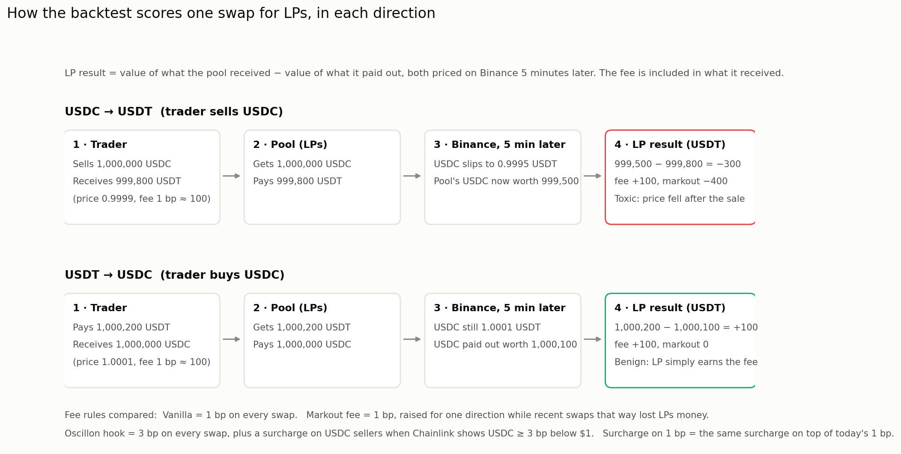
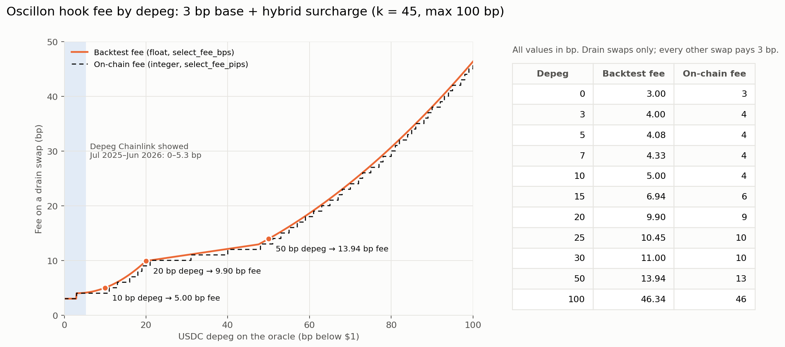
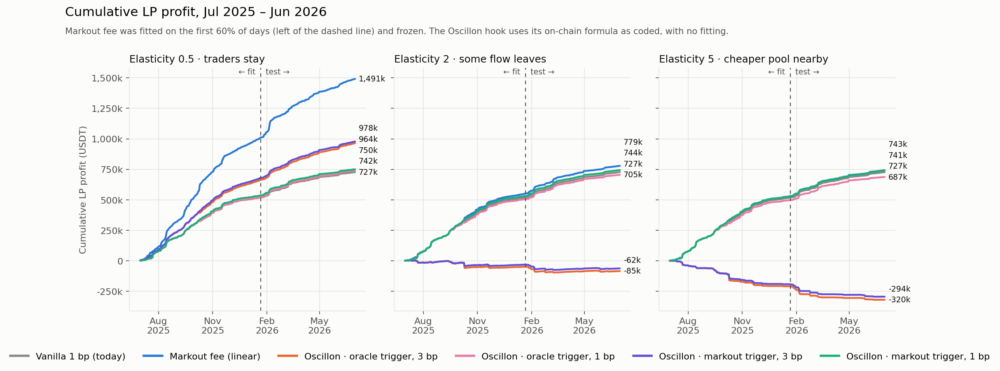
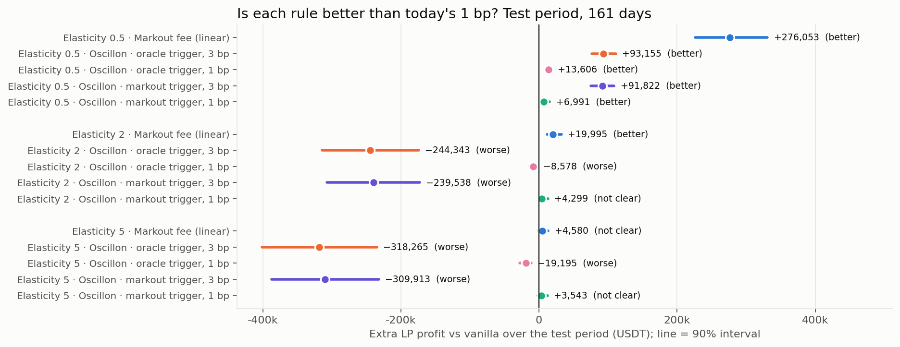
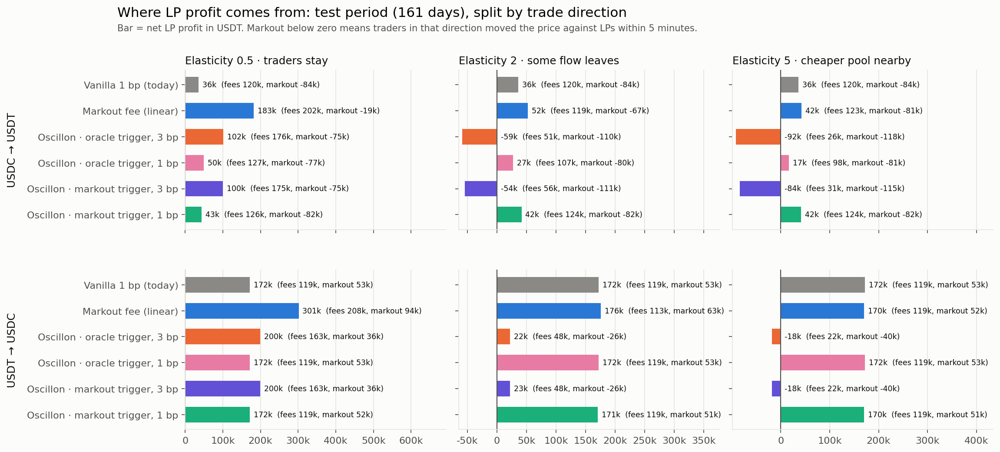
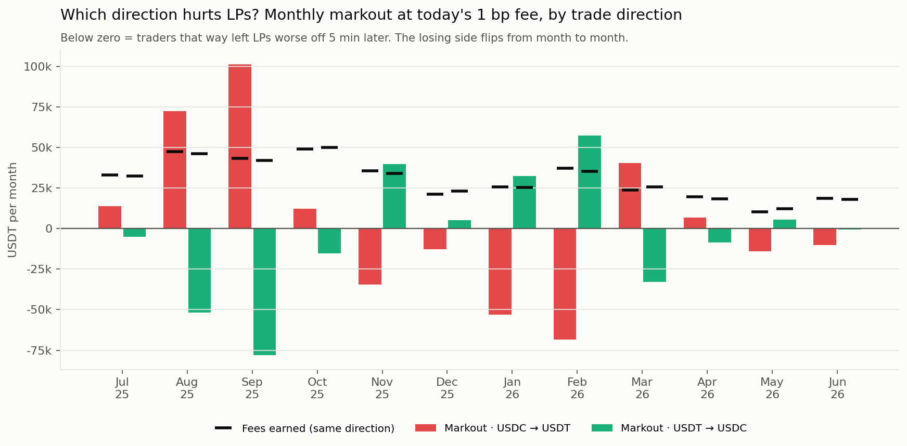
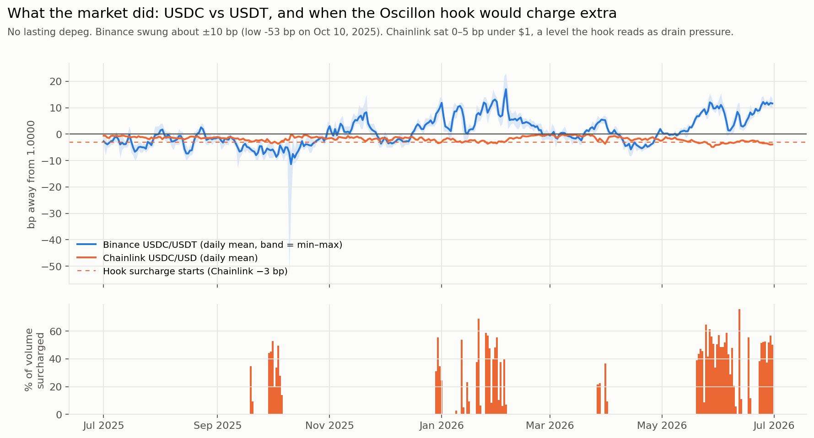

> **Superseded for decisions by `REPORT_HEAD_OF_LP.md`**, which leads with out-of-sample results and compares every crash result against vanilla. Kept for its detail on the markout trigger.

# Oscillon stable-fee hook: oracle trigger vs markout trigger

**USDC/USDT 1 bp pool, one calm year plus the Mar 2023 USDC depeg**

| | |
|---|---|
| Pool | Uniswap v3 USDC/USDT 0.01%, Ethereum (`0x3416…27c6`) |
| Calm year | Jul 1, 2025 – Jun 30, 2026 · $7.26B traded · fitted on the first 204 days, scored on the last 161 (Jan 21 – Jun 30, 2026) |
| Stress test | Mar 10 00:01 – Mar 25, 2023 · $4.0B traded · USDC low 0.870 · settings frozen from the calm-year fit |
| Fee formula | Oscillon hybrid surcharge, k = 45, max 100 bp, 3 bp dead band. **On-chain whole-bp rounding** (10 bp input → 4 bp fee) |
| Output | PNG charts in `charts_1y/` and `charts_2023_03/`; numbers in the `results_*.json` files |

---

## 1. Decision summary

1. **Don't launch at a 3 bp base, whichever trigger is used.**
   - In the calm year, a 3 bp base costs LPs about **$240k over 161 days** at moderate elasticity, with the oracle trigger or the markout trigger.
   - In the Mar 2023 crash it costs **$1.1M** at the same elasticity.
   - Arbitrage still trades at 3 bp. Ordinary flow, which was profitable for LPs, leaves.
2. **Driving the Oscillon curve from markout instead of the oracle is better in every test that measures real LP profit.**
   - Calm year, 1 bp base: +$4.3k vs today (not distinguishable from zero), against −$8.6k for the oracle trigger.
   - Crash, 1 bp base, against plain 1 bp (which made $240k): markout trigger **−$188k**, oracle trigger **−$665k**. Neither beat vanilla; the markout trigger lost less.
   - It also reacted **about 2 hours earlier** than the oracle in the crash, because Chainlink lagged the market.
3. **The trigger adds real value, but the curve shape limits it.**
   - Every dynamic rule beats a flat fee charged at its own average, so timing and direction matter, not just charging more.
   - The calm-year gain is small. The curve's 3 bp dead band rarely opens, because typical LP loss per trade is well under 1 bp.
   - The plain linear markout fee, which responds below 1 bp, earned more: **+$20k** vs today at moderate elasticity.
4. **The old 14.8% → 33.2% capture figure reproduces exactly** with on-chain rounding and the old 50 bp cap. With today's 100 bp cap it is 38.8% (39.9% on the float curve). The capture metric also ranks the triggers the opposite way to LP profit (section 5).

**Recommendation:**
- **Keep the 1 bp base.** Feed the surcharge from per-direction markout rather than the Chainlink level.
- **Next design to test:**
  - a lower dead band, or the linear markout mapping, for everyday flow
  - plus an oracle-based ceiling that only engages in a real depeg
- Measure elasticity from router data before any fee goes above 1 bp.


---

## 2. What was tested

### How a swap is scored

Every swap is valued from the LP's side:

```
LP result = value of what the pool received − value of what it paid out,
            both priced at the market (Binance USDC/USDT) 5 minutes later
          = fee income + markout
```

Both directions are scored separately: **USDC → USDT** (traders selling USDC) and **USDT → USDC** (traders buying USDC).



### The fee rules

| Rule | Base | What raises the fee | Who pays the surcharge |
|---|---|---|---|
| Vanilla (today) | 1 bp | nothing | nobody |
| Markout fee (linear) | 0.6–1 bp | measured LP loss in that direction × κ (fitted) | the direction currently losing LPs money |
| Oscillon · oracle trigger | 3 bp or 1 bp | Chainlink USDC/USD distance below $1 → hybrid curve | USDC sellers only |
| Oscillon · markout trigger | 3 bp or 1 bp | measured LP loss (bp) in that direction → **the same hybrid curve** | the direction currently losing LPs money |
| Flat control (one per rule) | — | nothing: a flat fee equal to that rule's own average fee in the same period | everyone |

**Markout trigger, exactly:**
- The keeper keeps a running, volume-weighted average of LP markout (in bp) on recent swaps, separately for each direction.
- It only uses swaps old enough to have settled: 60 s horizon, 15-minute lookback, both fitted on the calm year.
- If LPs are losing *x* bp per trade on one side, that side pays `base + hybrid_surcharge(x)` once *x* ≥ 3 bp.
- At *x* = 10 bp that is 3 + 1 = **4 bp**, the same table the contract uses for a 10 bp depeg.



### Counterfactual
- Traders whose 1-minute edge beats the new fee still trade.
- Everyone else shrinks by (fee / 1 bp)^−elasticity.
- **Elasticity is assumed, not measured**, so every result is shown at 0.5 (traders stay), 2 (some leave) and 5 (a cheaper pool nearby).

---

## 3. Check 1: does the markout trigger beat a flat fee? (calm year, elasticity 2)

Test period, 161 days, LP profit in USDT. "vs flat" is the rule minus a flat fee at its own average, with a 90% bootstrap range by day.

| Rule | LP profit | vs today | vs its flat control |
|---|---|---|---|
| Vanilla 1 bp | 207,970 | — | — |
| **Markout fee (linear)** | **227,964** | **+19,995** [+11,513, +32,751] | **+59,879** [+41,168, +78,671] |
| Oracle trigger, 3 bp | −36,373 | −244,343 [−313,871, −174,473] | +3,050 [+1,288, +4,899] |
| Oracle trigger, 1 bp | 199,391 | −8,578 [−14,268, −3,350] | +13,111 [+3,559, +22,464] |
| Markout trigger, 3 bp | −31,569 | −239,538 [−307,304, −172,724] | +8,513 [+2,770, +16,487] |
| **Markout trigger, 1 bp** | **212,269** | +4,299 [−693, +13,086] | **+16,550** [+8,816, +26,078] |

What this shows:
- **The markout trigger's gain is not just a higher fee.** It beats its flat control at every elasticity: +$5k at 0.5 (not significant), +$17k at 2, +$40k at 5.
- **The oracle trigger adds almost nothing over a flat 3 bp** (+$3k). In a calm year it behaves like a flat fee.
- **The linear markout fee does best.** The Oscillon curve does nothing below 3 bp of measured loss, then jumps a whole bp, and calm-year toxicity sits well below 1 bp. The linear rule charges in proportion from the first fraction of a bp.
- **At elasticity 0.5, every rule that raises fees looks good.** Sticky flow pays anything. The flat control shows which part is real: linear markout +$173k over its flat, Oscillon rules only +$3k to +$9k.





### Both directions

At today's 1 bp, the side that hurts LPs flips:
- **Fit period:** USDC sellers *gave* LPs +$138k of markout, while USDC buyers cost −$105k.
- **Test period:** USDC sellers cost −$84k and buyers gave +$53k.
- Month by month it flips several times.
- So the oracle hook, which only ever charges USDC sellers, is right in some months and wrong in others. The markout trigger follows whichever side is losing.







---

## 4. Check 2: oracle vs markout trigger in the Mar 2023 crash

Mar 10 00:01 – Mar 25, 2023, crash hours included. Settings frozen from the calm year, nothing refit. LP profit in USDT.

| Rule | Elasticity 0.5 | Elasticity 2 | Elasticity 5 |
|---|---|---|---|
| Vanilla 1 bp | 240,196 | 240,196 | 240,196 |
| Markout fee (linear) | **1,281,772** | 201,564 | −220,419 |
| Oracle trigger, 3 bp | 113,359 | −901,647 | −1,035,786 |
| Oracle trigger, 1 bp | 63,879 | −424,983 | −463,215 |
| Markout trigger, 3 bp | 208,785 | −821,398 | −954,915 |
| **Markout trigger, 1 bp** | **318,822** | **52,613** | −209,183 |

**Same base, markout trigger minus oracle trigger:**
- At 1 bp: +$255k (elasticity 0.5), **+$478k** (2), +$254k (5).
- At 3 bp: +$95k, +$80k, +$81k.
- The direction is the same at every elasticity. Each rule's own 90% range against vanilla is wide, because 15 crash days is a small sample (full ranges in S3).

**Every dynamic rule beats its own flat control in the crash, by a lot:**
- Markout trigger at 1 bp, elasticity 2: +$783k.
- Charging the whole pool the average crash fee pushes away the flow that was profitable for LPs. Charging only the side that is hurting LPs does not.

**At elasticity 2 or more, almost every rule still loses to plain 1 bp.**
- High fees push away the flow that was buying cheap USDC, which made money for LPs as USDC recovered.
- Arbitrageurs with a large edge keep trading.
- Only the linear markout fee and the markout trigger at 1 bp stay close to break-even.

### Reaction speed

| Event | Time (UTC) |
|---|---|
| Market USDC/USDT first below 0.995 (Kraken-filled) | Mar 10 22:03 |
| Linear markout fee first ≥ base + 10 bp on USDC sellers | Mar 10 22:14 (+11 min) |
| **Markout trigger first ≥ base + 10 bp** | **Mar 10 22:35 (+32 min)** |
| Chainlink USDC/USD first below 0.995 | Mar 11 01:24 |
| **Oracle trigger first ≥ base + 10 bp** | **Mar 11 00:40 (+2 h 37 min)** |
| Oracle trigger first ≥ base + 30 bp | Mar 11 01:56 |
| Markout trigger first ≥ base + 30 bp | Mar 11 03:42 |

- **The usual expectation was that the oracle reacts first. Here it didn't.** Chainlink USDC/USD lagged the market by about 3 hours on the way down.
  - USDC sold into the pool between Mar 10 15:00 and each trigger's first ≥ 10 bp surcharge: **$184M under the oracle trigger, $157M under the markout trigger**.
- **The oracle trigger charges more once a depeg is deep.**
  - It sat at the 100 bp cap from Mar 11 to Mar 13.
  - The markout trigger spiked in bursts, because the measured loss per trade is smaller than the depeg itself.
  - That is the case for an oracle ceiling as a backstop, which is the next design to test.


---

## 5. Check 3: capture on the exact old file (14.8% → 33.2%)

This uses `prepared_swaps_2023-03.csv` from research-backtest, with its own engine and accounting:
- **Spread:** the Chainlink depeg on drain flow.
- **Tape:** fixed, no volume loss.
- **Size:** 6,232 one-minute rows, Mar 10 – Mar 15.

| Rule | LP income | LVR proxy | Capture |
|---|---|---|---|
| Static 3 bp (old) | $214,645 | $1,237,700 | **14.8%** (reproduces) |
| Oscillon hybrid, float (current repo code) | $578,826 | $873,519 | **39.9%** |
| Flat 8.09 bp (the hybrid's average fee) | $578,826 | $1,095,640 | 34.6% |
| **Oscillon hybrid, on-chain rounding** | $563,030 | $889,315 | **38.8%** |
| Markout trigger, 3 bp | $301,898 | $1,203,377 | 20.1% (its flat: 20.1%) |
| Markout trigger, 1 bp | $137,033 | $1,271,952 | 9.7% (its flat: 9.7%) |

**Why this ranks the triggers the other way:**
- The capture metric assumes every unit of drain flow loses the full Chainlink depeg, and that no flow ever leaves.
- So it rewards charging the highest fee wherever the oracle depeg is largest. That favours the oracle trigger by construction.
- It cannot see whether a trade actually hurt LPs, or what happens to the flow that leaves.
- The markout accounting in sections 3–4 measures exactly that, and prefers the markout trigger.
- **For a decision about LP income, the markout accounting is the one to trust.** Capture is a useful upper-bound view of the spread on drain flow.

**On 33.2%:**
- **33.2% reproduces exactly:** on-chain whole-bp rounding (`scripts/backtest_mainnet.py`) with the 50 bp cap that applied before commit 27d97ab (Jul 30, 2026). The float curve with that cap gives 34.3% (BACKTEST_AUDIT.md). With today's 100 bp cap: 38.8% on-chain, 39.9% float.
- With on-chain rounding it is 38.8%.
- Against a flat fee at the same average it is +4.2 points, so the curve's shape adds a little on this metric too.


---

## 6. Data and method

| Input | Source | Note |
|---|---|---|
| Pool flow, calm year | research-backtest `data/ethereum-0x3416…-YYYY-MM-DD.minute.csv` (365 files) | Per-minute bars split into USDC→USDT and USDT→USDC legs. Two file conventions for gross volume, detected per file; 0 negative legs |
| Pool flow, Mar 2023 | same, Mar 10–25, 2023 | 22,167 legs |
| Market price | Binance USDC/USDT 1-minute closes | Binance relisted USDC/USDT only at Mar 11, 2023 14:00 UTC |
| Crash hours fill | Kraken USDC/USD ÷ USDT/USD, 1-minute, from 250k public trades | Overlap with Binance (1,320 min): median gap 2.6 bp, mean absolute 17.6 bp, 95th pct 73 bp, max 114 bp, almost all of it Mar 12 00:00–06:00 |
| Oracle | Chainlink USDC/USD exports in research-backtest | Last value strictly before each swap |
| Fee curve | `research-backtest/src/oscillon_fee.py`, ported and checked: on-chain path matches `select_fee_pips` at 0, 3, 5, 7, 10, 15, 20, 25, 30, 50, 100 bp | |

**Fitting:** only the markout settings were fitted, on the first 204 calm days: horizon, lookback, per-direction or pooled. For the linear rule, κ and the base were fitted too. Nothing was fitted on the test period or the crash.

## 7. Limits

- **Minute data, not individual swaps.** Toxicity inside a single minute nets out, so arbitrage losses are understated for every rule.
- **Elasticity is assumed.** It decides the answer for any fee above 1 bp. Measure it from aggregator fills (1inch / 0x / CoW) across USDC/USDT venues.
- **Crash-hours prices are noisy.** The Kraken fill disagrees with Binance by tens of bp in the worst hours, so markouts (and the markout trigger) are noisy then.
- **The volume model is crude in a panic.** Flow that leaves is assumed to leave in proportion, whatever its direction.
- **Fifteen crash days give wide intervals.** Read the direction of the differences, not the exact dollars.
- **The linear markout fee's best calm-year setting at elasticity 0.5 is at the edge of its grid** (κ = 16).
- **First-order counterfactual**: no price impact from dropped trades, and no gas.

## 8. Reproduce

```bash
# calm year
python3 prepare_minute_year.py --bars ../../../research-backtest/data --pool 0x3416cf6c708da44db2624d63ea0aaef7113527c6 \
    --start 2025-07-01 --end 2026-06-30 --klines klines_1y \
    --oracle ../../../research-backtest/data/chainlink_usdc_2025-07_2026-06.csv --out-dir data_1y
python3 backtest.py --swaps data_1y/swaps.csv --ref data_1y/ref.csv --oracle data_1y/oracle.csv --fee 0.0001 \
    --h-decision 60 --h-eval 300 --policies markout,hook,hook_poolfee,markout_hook,markout_hook_poolfee \
    --sweep 0.5,2,5 --out results_usdc_usdt_1year.json --daily-out data_1y/daily_results.csv
python3 make_charts.py --results results_usdc_usdt_1year.json --daily data_1y/daily_results.csv \
    --data data_1y --out charts_1y --names USDC,USDT

# Mar 2023: Kraken fill for the hours before Binance relisted, then the frozen-settings stress test
python3 fetch_kraken.py --base USDCUSD --quote USDTZUSD --start 2023-03-10 --end 2023-03-12T12:00 \
    --out klines_2023_03/kraken_USDCUSDT-1m.csv
python3 prepare_minute_year.py --bars ../../../research-backtest/data --pool 0x3416cf6c708da44db2624d63ea0aaef7113527c6 \
    --start 2023-03-10 --end 2023-03-25 --klines klines_2023_03 \
    --oracle ../../../research-backtest/data/chainlink_usdc_2023.csv --out-dir data_2023_03
python3 run_stress.py --params results_usdc_usdt_1year.json --data data_2023_03 --fee 0.0001 \
    --out results_usdc_usdt_2023_03.json --charts charts_2023_03 --names USDC,USDT
python3 replicate_old_2023.py --repo ../../../research-backtest --fees data_2023_03/fees_eps2.0.csv \
    --out results_old_2023_capture.json --png charts_2023_03/S4_capture_vs_old_result.png
```
