# Dynamic LP fees for stablecoin pools: what survived testing

*Every figure comes from replaying real pool flow under each fee rule and scoring every trade from the LP's side. Charts are PNGs in this folder.*

| | USDC/USDT (main study) | USDe/USDT (real swaps) | March 2023 USDC depeg |
|---|---|---|---|
| Window | Jul 1, 2025 – Jun 30, 2026 | Oct 2, 2025 – Aug 20, 2026, **excluding Oct 10–11** | Mar 10 – Mar 25, 2023 |
| Fitted on / scored on | first 204 days / **last 161 days** | first ~190 days / **last 122 days** (Apr 21 – Aug 20, 2026) | nothing refit: settings frozen from the USDC/USDT fit |
| Volume | $7.26B | $9.20B | $4.0B |
| Pool LP fee today | 1 bp | 0.45 bp (read on-chain) | 1 bp |
| Market price | Binance USDC/USDT, 1 min | Binance USDe/USDT, 1 min | Kraken USDC/USD ÷ USDT/USD until Mar 11 14:00, Binance after |

**Term used throughout: adverse markout.**
- Adverse markout = what LPs lost on trades the market then moved against, priced 5 minutes after each trade. Net markout adds back what they gained on trades the market moved back.
- This is a trade-level measure, not LVR in the Milionis et al. sense.

---

## 1. Answer first (out of sample)

1. **On USDC/USDT, LPs at 1 bp lost about $0 net to informed flow over a full year.**
   - Net markout over 365 days was +$1k, against $726k of fees.
   - There is little to fix on this pair in a normal year.
2. **The Oscillon hook as coded (3 bp base, one-sided oracle trigger) loses to plain 1 bp in the calm year and in the March 2023 crash.**
   - Calm year, elasticity 2: **−$244k**.
   - Crash, elasticity 2: **−$1.14M**.
   - In the crash recovery it charged **USDC sellers up to 100 bp while USDC buyers were the side hurting LPs** (section 3).
3. **One rule survives:** a per-direction fee driven by measured LP losses (the linear markout fee), on the pool's own base fee.
   - USDC/USDT out of sample: **+$20k** at elasticity 2 (90% range +$11.5k to +$32.8k).
   - It beats a flat fee at its own average fee by +$60k, so the gain comes from timing and direction, not from charging more.
   - In the crash it was **roughly neutral**: −$39k vs vanilla, range −$296k to +$141k.
4. **On USDe/USDT the same rule gained +$40k out of sample** at elasticity 2 (range +$26k to +$54k), with Oct 10–11 excluded.
   - On USDe and four other non-major stables, **selling the riskier coin is consistently the side that hurts LPs**.
   - **Promising, not proven.**
5. **Open before building:**
   - measured elasticity (first estimate: between 0.4 and 3, section 4)
   - APR on TVL
   - a clean reference price for stressed days

### Every rule against plain vanilla

**Calm markets, out of sample** (change in LP profit vs today's fee):

| Rule | USDC/USDT · ε 0.5 | **USDC/USDT · ε 2** | USDC/USDT · ε 5 | USDe/USDT · ε 0.5 | **USDe/USDT · ε 2** | USDe/USDT · ε 5 |
|---|---|---|---|---|---|---|
| **Markout fee (linear)** | +$276k [226k, 331k] | **+$20k [11.5k, 32.8k]** | +$4.6k [−0.9k, 13.5k] | +$96k [74k, 122k] | **+$40k [26k, 54k]** | +$18k [7k, 32k] |
| ↳ vs flat fee at its own average | +$173k | +$60k [41k, 79k] | +$47k | +$53k | +$86k [63k, 112k] | +$125k |
| Oscillon curve, markout trigger, pool base | +$7.0k | +$4.3k [−0.7k, 13.1k] | +$3.5k | +$5.4k | +$0.1k [−5.3k, 3.7k] | +$5.1k |
| Oscillon curve, oracle trigger, pool base | +$13.6k | −$8.6k [−14.3k, −3.4k] | −$19.2k | +$33k | −$37k [−65k, −13k] | −$49k |
| Oscillon hook as coded, 3 bp | +$93k | **−$244k** | −$318k | +$117k | **−$112k** | −$123k |

**March 2023 crash** (Mar 10–25, settings frozen from the calm year). Vanilla 1 bp made **$240k** in the crash: $398k of fees minus $158k of net markout.

| Rule (1 bp base unless stated) | ε 0.5 | **ε 2** | ε 5 |
|---|---|---|---|
| Markout fee (linear) | +$1.04M [571k, 1.57M] | **−$39k [−296k, +141k]** | −$461k |
| Oscillon curve, markout trigger | +$79k [−14k, 181k] | **−$188k [−547k, +14k]** | −$449k |
| Oscillon curve, oracle trigger | −$176k [−381k, +1k] | **−$665k [−1.25M, −195k]** | −$703k |
| Oscillon hook as coded, 3 bp | −$127k [−355k, +88k] | **−$1.14M [−1.88M, −507k]** | −$1.28M |

**No dynamic rule beat plain 1 bp in the crash once traders can leave (elasticity 2 or 5).** The linear markout fee is the only one whose range includes zero at elasticity 2.

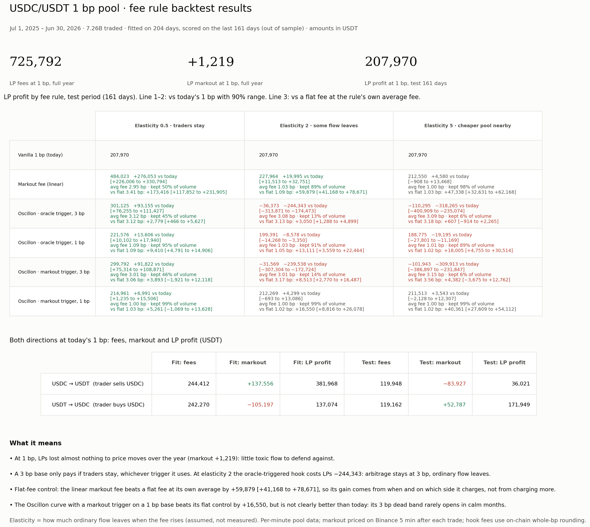

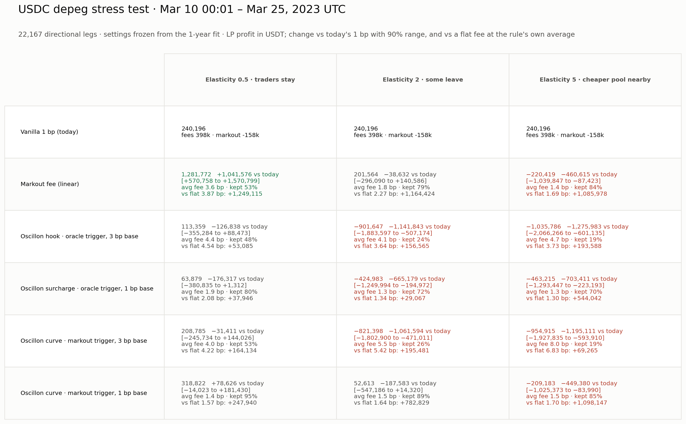

---

## 2. Corrections in this version

| What | Before | Now | Why |
|---|---|---|---|
| Headline numbers | Whole-year figures (+$51k USDC/USDT, +$510k USDe) | **Out-of-sample figures** (+$20k, +$40k) | Whole-year figures include the days the rules were fitted on |
| Crash result for the markout trigger | "+$53k" | **−$188k vs vanilla** | +$53k was crash LP profit. Vanilla made $240k |
| USDe Oct 10–11, 2025 | shown both ways | **excluded** | Binance USDe printed 0.665 while other venues stayed near $1: an exchange dislocation, not market price |
| USDe sellers "cost LPs $1.07M" | headline | **withdrawn** | Almost all of it came from Oct 10–11 on Binance. Without it, the selling side's net markout is −$55k on Binance prices |
| "LVR" | used for markout losses | **"adverse markout"** | LVR is a defined quantity; this is trade-level markout |
| Cross-pair "7–21× fees" | headline | **dropped**; bp of volume instead | Small-denominator effect at 0.05 bp fee tiers |
| Oracle backstop `max(markout, oracle)` | recommended | **untested hypothesis** | In March 2023 the oracle charged the wrong side during the recovery |
| Published 33.2% capture | "doesn't reproduce" | **reproduced exactly** (section 6) | On-chain rounding with the old 50 bp cap |

---

## 3. March 2023: why the oracle hook failed in the crash

Mar 10 18:00 – Mar 14, 2023, today's 1 bp flow, 6-hour windows:

| Side | LP net markout | Oracle hook fee charged |
|---|---|---|
| USDC sellers (USDC → USDT) | **+$435k** (LPs bought USDC cheap; it recovered) | 22–100 bp, **at the 100 bp cap from Mar 11 06:00 to Mar 12 18:00** |
| USDC buyers (USDT → USDC) | **−$526k** (they bought cheap USDC before it bounced) | **3 bp throughout** |

- **The oracle charged the wrong side for most of the crash.**
  - USDC buyers hurt LPs in 10 of 13 windows.
  - USDC sellers were toxic only around the turning points: the first hours of the fall (Mar 10 18:00) and briefly Mar 11 18:00.
  - The oracle only reads "USDC below $1", so it kept charging sellers during the recovery.
- **The markout trigger reacted earlier:** 32 minutes after the market broke 0.995, against 2 h 37 min for the oracle trigger. Chainlink USDC/USD lagged the market by about 3 hours on the way down.
- **A fee can't protect LPs from the depeg itself, only from part of the arbitrage.**
  - The old metric counted drain volume × the full distance from $1 as loss to defend: $1.24M over 6 days.
  - Scored trade by trade, vanilla LPs lost $158k net to arbitrage and earned $398k in fees, so they made money through the crash.
  - The difference is the cost of holding USDC while it was down, which reversed when USDC recovered.
  - If a depeg were permanent, no fee would save LPs; only withdrawing liquidity would.
- **Caveats:**
  - **The crash windows before Mar 11 14:00 are priced on the Kraken fill**, which disagreed with Binance by tens of bp in those hours. The Mar 11 00:00–06:00 window shows USDC sellers *gaining* LPs money while USDC fell, which is implausible; treat those windows with caution.
  - **On Binance-priced data only (Mar 11 18:00 onward, the recovery):** USDC buyers −$345k, USDC sellers +$312k, while the oracle charged sellers 12–100 bp (100 bp until Mar 12 18:00) and buyers 3 bp in every window. The wrong-side finding holds on clean data.
  - **Each window's buyer and seller numbers are close to mirror images.** Part of that is price drift applied to two-sided minute flow. Per-swap data would sharpen this.

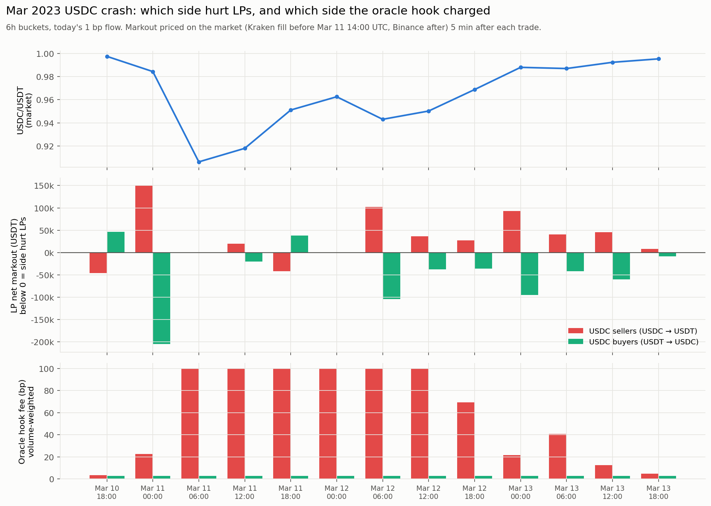

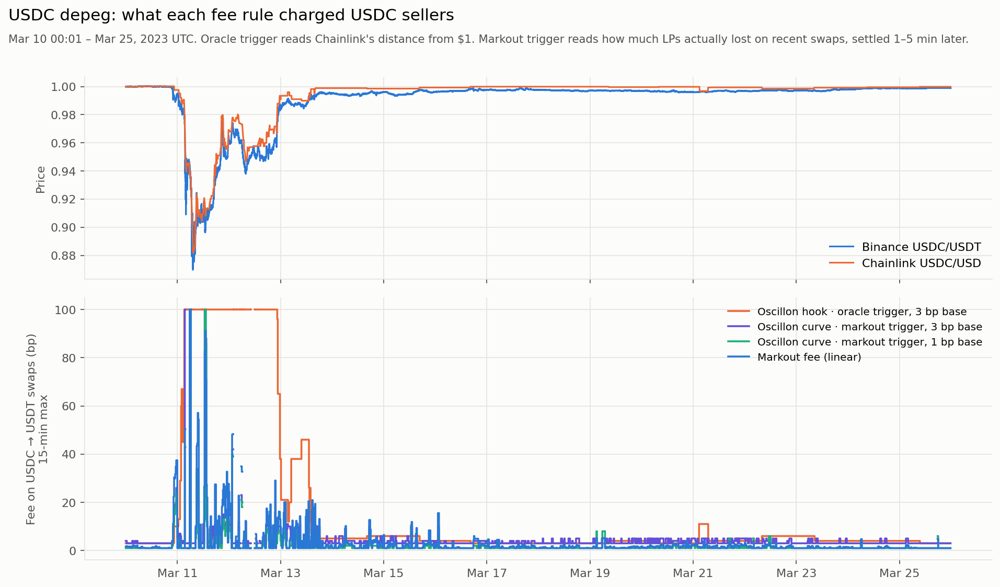

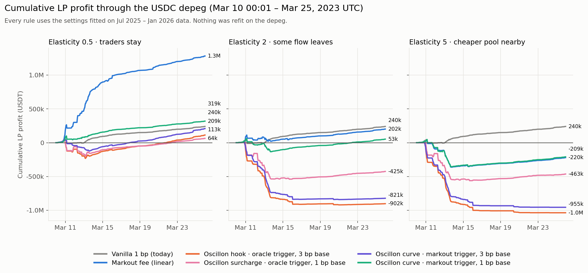

---

## 4. Elasticity: the assumption that decides most results

The backtest assumes ordinary traders drop off as `(fee / base fee)^−elasticity`. At elasticity 2, a 3 bp fee on a 1 bp pool keeps 11% of ordinary flow.

**First measurement:** USDC/USDT 0.01% vs 0.05% pools on Ethereum, daily volume from GeckoTerminal.

| Window | 1 bp pool volume | 5 bp pool volume | 5 bp share | Raw elasticity | Depth-adjusted |
|---|---|---|---|---|---|
| Jan 2 – Jun 30, 2026 (in the backtest year) | $2,776M | $21.0M | 0.75% | **3.0** | **0.41** |
| Last 180 days (Apr – Oct 2026) | $1,989M | $15.1M | 0.75% | 3.0 | 0.41 |

How to read it:
- **Raw (3.0)** treats the pools as equally deep, which overstates how fast flow leaves.
- **Depth-adjusted (0.41)** divides by today's pool depth ($0.50M vs $34M), which understates it, because liquidity follows volume.
- **The true value is most likely between about 0.4 and 3.** That brackets the 0.5 and 2 columns and makes 5 look pessimistic.
- **Missing:**
  - March 2023, which needs paid GeckoTerminal history or an archive RPC key.
  - Competing venues outside these two pools: Curve, Fluid, CEXs.

---

## 5. Whole period by direction (includes fitted days)

*These figures include the days the fitted rules were fitted on. Use section 1 for decisions.*

### USDC/USDT, Jul 2025 – Jun 2026, elasticity 2

| Rule | Direction | Volume (kept) | Fees | Adverse markout | Benign gain | **LP profit** | Trader profit (winning trades) |
|---|---|---|---|---|---|---|---|
| Today, 1 bp | USDC → USDT | $3.64B | 364k | −432k | +486k | **418k** | −418k (284k) |
| | USDT → USDC | $3.61B | 361k | −441k | +388k | **309k** | −309k (260k) |
| | **Both** | $7.26B | 726k | −873k | +874k | **727k** | −727k (544k) |
| Markout fee (linear) | USDC → USDT | $3.33B (91%) | 379k | −390k | +478k | **467k** | −467k (228k) |
| | USDT → USDC | $3.24B (90%) | 351k | −404k | +364k | **311k** | −311k (233k) |
| | **Both** | $6.57B (91%) | 731k | −794k | +842k | **778k** | −778k (461k) |
| Oscillon hook as coded, 3 bp | **Both** | $1.09B (15%) | 331k | −512k | +96k | **−85k** | +85k (330k) |
| Oscillon curve, markout trigger, 1 bp | **Both** | $7.20B (99%) | 741k | −868k | +870k | **744k** | −744k (522k) |

- **Gross adverse markout and benign gain net to about zero at today's fee.** Part of each is noise from minute-level prices; net markout and LP profit are the robust numbers.
- **A 3 bp base cuts adverse markout by $361k but loses $778k of benign gains and more than half the fees.** The flow that leaves was the flow paying LPs.

### USDe/USDT, Oct 2025 – Aug 2026 without Oct 10–11, elasticity 2

| Rule | Direction | Volume (kept) | Fees | Adverse markout | Benign gain | **LP profit** |
|---|---|---|---|---|---|---|
| Today, 0.45 bp | USDe → USDT | $4.62B | 208k | −336k | +281k | **153k** |
| | USDT → USDe | $4.58B | 206k | −264k | +311k | **253k** |
| | **Both** | $9.20B | 414k | −600k | +592k | **406k** |
| Markout fee (linear) | **Both** | $6.07B (66%) | 342k | −324k | +525k | **543k (+136k)** |
| Oscillon curve, markout trigger, 0.45 bp | **Both** | $9.04B (98%) | 422k | −593k | +582k | **412k (+5k)** |
| Oscillon curve, oracle trigger, 0.45 bp | **Both** | $6.04B (66%) | 343k | −473k | +397k | **267k (−139k)** |
| Oscillon hook as coded, 3 bp | **Both** | $0.31B (3%) | 107k | −146k | +11k | **−28k (−434k)** |

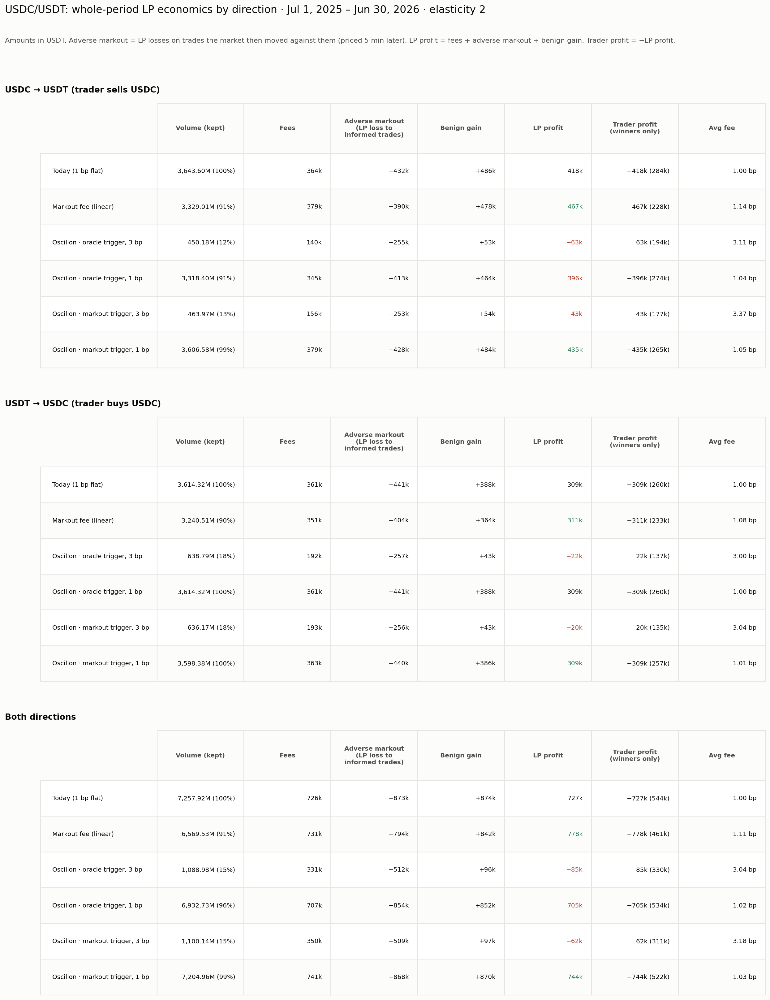

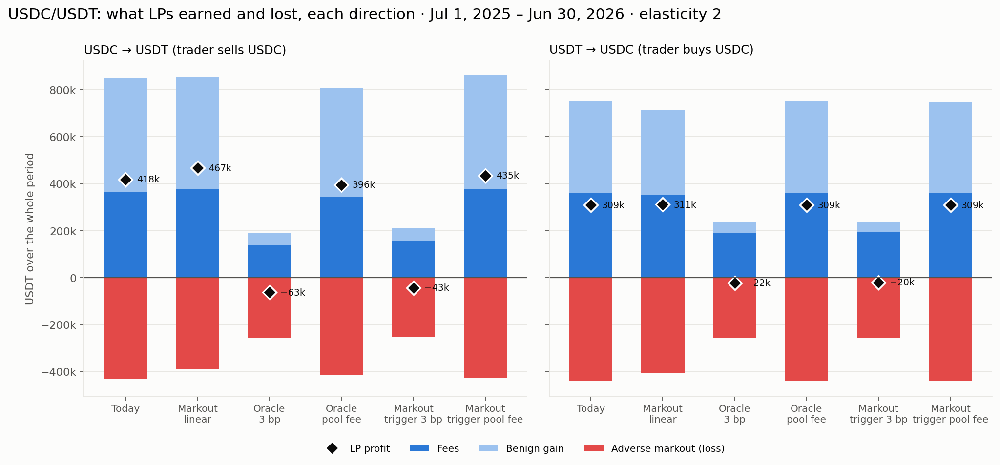

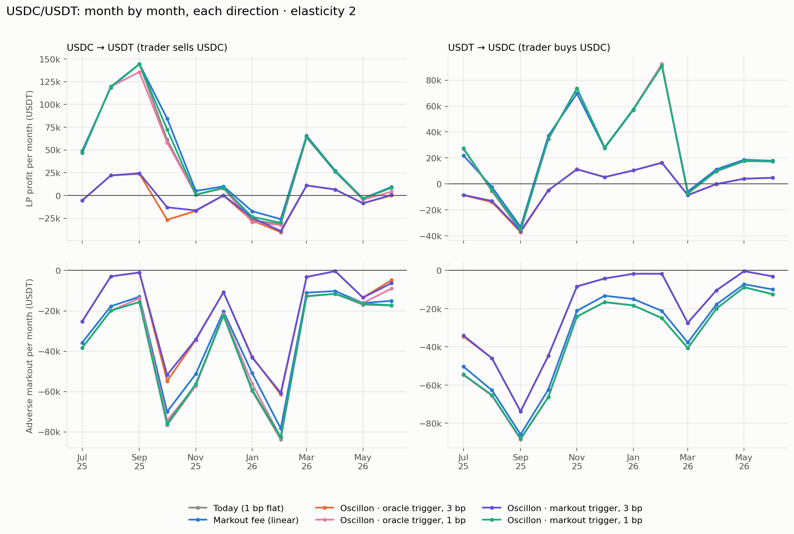

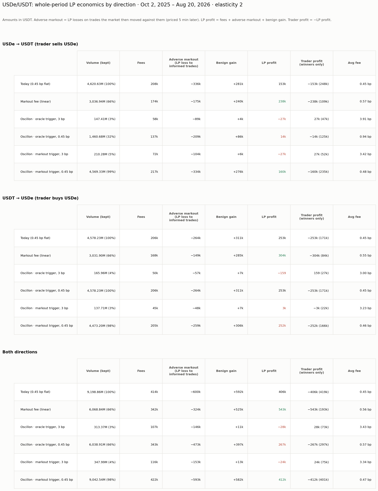

---

## 6. The published 33.2%, reconciled

Same file (`prepared_swaps_2023-03.csv`), same research-backtest engine and capture metric. Only two settings differ:

| Fee path | 50 bp cap (before Jul 30, 2026) | 100 bp cap (commit 27d97ab, Jul 30, 2026) |
|---|---|---|
| On-chain whole-bp rounding (`scripts/backtest_mainnet.py`) | **33.2%** (LP $481,857 · LVR proxy $970,488): BACKTEST.md | 38.8% |
| Float curve (`select_fee_bps`) | 34.3% (LP $497,602 · LVR proxy $954,743): BACKTEST_AUDIT.md | 39.9% |

- **Static 3 bp is 14.8% in every version.**
- **A flat 8.09 bp fee scores 34.6%** on this metric, so the curve's targeting adds about 4–5 points.
- **This metric favors the oracle by construction.** It counts every unit of drain flow as losing the full oracle depeg, and assumes no trader ever leaves. The trade-level LP profit in sections 1 and 3 is the measure to use for decisions.

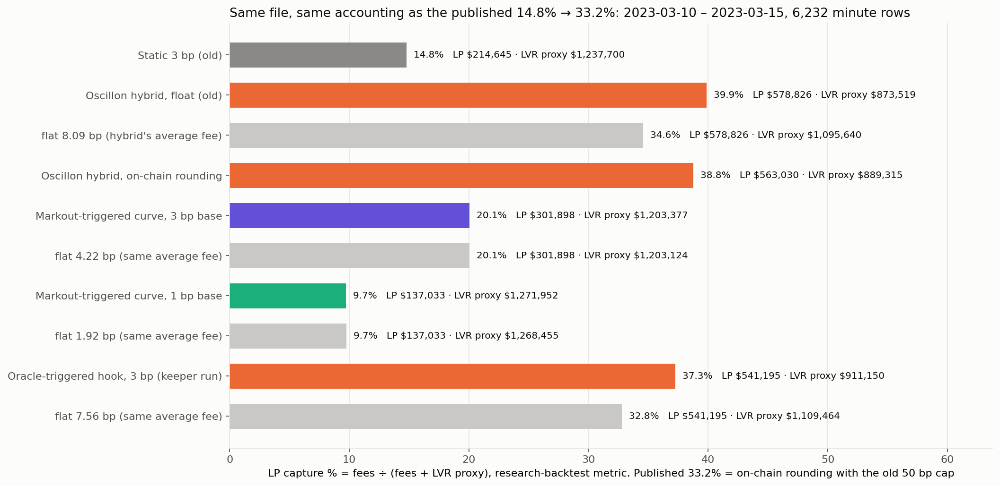

---

## 7. Other pairs: is the toxic direction stable?

Five more pools have real swap data but no fast market price, so all seven are compared on one yardstick: LP markout against **the pool's own price 5 minutes later**. That catches losses that arbitrage later corrects in the pool. It misses losses while the pool stays mispriced, so it is a lower bound.

| Pair | Category | LP fee | Volume / day | Side that hurts LPs | Adverse markout, bp of volume | Net markout, bp of volume |
|---|---|---|---|---|---|---|
| USDC/USDT | Fiat-backed majors | 1 bp | $19.9M | flips month to month | 0.88 | +0.19 |
| USDe/USDT | Synthetic / yield-bearing | 0.45 bp | $29.1M | **selling USDe** (10 of 11 months, without Oct 10–11) | 0.65 | +0.13 |
| USDe/USDC | Synthetic / yield-bearing | 0.25 bp | $8.9M | selling USDe | 0.35 | +0.63 |
| USDS/USDT | Decentralised (CDP) | 0.05 bp | $28.8M | no clear side | 1.06 | +3.25 |
| PYUSD/USDS | Fiat-backed minor | 0.05 bp | $18.1M | selling PYUSD | 0.38 | +0.13 |
| FRAX/USDC | Fractional / algorithmic | 5 bp | $23k | selling FRAX | 6.99 | −0.99 |
| AUSD/USDC | Fiat-backed, Monad | 0.5 bp | $240k | selling AUSD | 0.39 | −0.11 |

- **The direction pattern is real in the data.** In every non-major pair except USDS, the side selling the riskier coin is the one hurting LPs.
  - On USDe/USDT it holds against the pool's own price (sellers −$361k, buyers +$498k without Oct 10–11).
  - It also holds against Binance, but much smaller (sellers −$55k, buyers +$47k).
- **The dollar opportunity is not established.** Adverse markout is about 0.4–1 bp of volume on most pairs, similar to USDC/USDT. FRAX is higher, but on $23k a day.

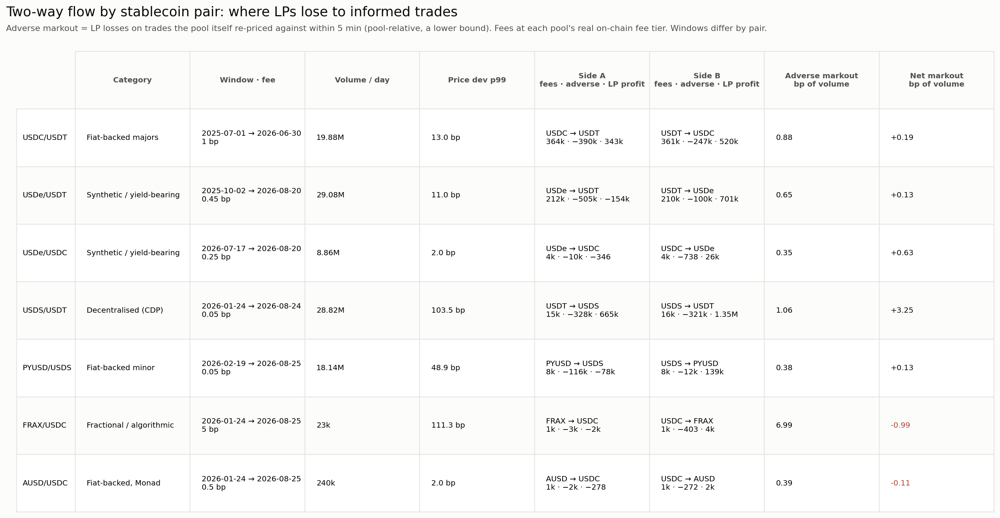

---

## 8. What an LP or market maker will look for

| Question | What this study shows | Gap |
|---|---|---|
| **Net LP return per $ of TVL** (APR uplift) | Pool-level LP profit by rule and direction | **No TVL or position-level P&L vs holding yet** |
| **Out-of-sample robustness** | 60/40 split; frozen-settings crash test; flat-fee control | Rolling windows; a second calm year |
| **Volume and market share** | Volume kept per rule; first elasticity bracket 0.4–3 | Router-level measurement; competing venues |
| **Tail behavior** | Crash results against vanilla; side-by-side direction split | Worst-day loss and drawdown per rule |
| **Who pays** | Trader profit and winning trades by direction | Counterparty tagging (aggregators, solvers, arbitrage bots) |
| **Gaming** | Fee never drops below base | Test splitting and timing toxic flow around the measurement window |
| **Integration and operations** | Needs a keeper and a market price feed | Router quoting of dynamic fees; keeper latency; audit |

## 9. What to change

**Mechanism:**
1. **Base fee = the pool's competitive fee.** Only the surcharge moves.
2. **Two-sided, per-direction surcharge driven by measured LP losses** (markout), pushed by a keeper.
3. **No dead band; respond linearly from small losses.** Floor the fee at the base fee.
4. **Drop the USD oracle as a trigger for stable/stable pairs.** It lagged by about 3 hours in March 2023, and charged the wrong side in the recovery.
   - `max(markout, oracle)` as a depeg backstop is an **untested hypothesis**, not a recommendation.

**Output:**
1. APR uplift per $ of TVL, and LP position P&L vs holding.
2. Per-swap USDC/USDT data (archive RPC key). That removes the minute-level netting, and the +$20k may move either way.
3. Markout curves by direction at 10 s, 1 min, 5 min and 1 h.
4. Worst-day loss and drawdown per rule, plus a fee histogram.

## 10. Is it worth building a product?

**Not yet decided. The evidence points to one narrow, testable product:**
- A keeper policy on the pool's own base fee that adds a per-direction surcharge when measured LP losses on that side rise.
- On USDC/USDT it adds about **$45k a year** at elasticity 2 on a pool earning $726k in fees. That's real for LPs, but thin as a business on its own.
- **The hypothesis worth testing:** in non-major pegged assets, selling the riskier coin is consistently the toxic side, so a per-direction fee has a stable target.
  - That fits stablecoin issuers paying to keep LPs in their pools. A USDe-type issuer is the natural first customer.
  - On USDe/USDT the rule added +$40k out of sample over 122 days. Promising, not proven.

**In this order:**
1. **Elasticity:** extend the 1 bp vs 5 bp comparison to March 2023, and to USDe if it has two fee tiers.
2. **USDe redone with TVL** to quote APR uplift, using rolling out-of-sample windows. Oct 10–11 stays excluded or gets repriced from on-chain pools.
3. **Per-swap USDC/USDT** for the year and March 2023.
4. **Only then** one LST pair (e.g. wstETH/WETH).
5. **Decide:** if the markout fee still wins at the measured elasticity, build it as a keeper policy (the contract barely changes). If not, stop building fee mechanisms for stable pairs and publish the findings.

---

## Appendix: files

| What | Where |
|---|---|
| USDC/USDT out-of-sample summary with flat controls | `charts_1y/00_results_summary.png`, `results_usdc_usdt_1year.json` |
| USDC/USDT whole period by direction | `charts_1y/Y1`–`Y4`, `results_usdc_usdt_1year_breakdown.json` |
| USDe/USDT without Oct 10–11 | `results_usde_usdt_ex_oct10.json`, `charts_usde/Uex1`–`Uex4` |
| March 2023 crash | `charts_2023_03/S1`–`S5`, `results_usdc_usdt_2023_03.json`, `results_crash_direction_split.csv` |
| 33.2% reconciliation | `charts_2023_03/S4_capture_vs_old_result.png`, `results_old_2023_capture.json` |
| Elasticity | `data_elasticity/geckoterminal_daily_volume.csv` |
| Cross-pair flow | `charts_cross_pair/C1_two_way_profile.png`, `results_cross_pair_profile.json` |
| Scripts | `prepare_minute_year.py`, `prepare_swaps_raw.py`, `backtest.py`, `full_year_breakdown.py`, `cross_pair_profile.py`, `run_stress.py`, `crash_direction_split.py`, `replicate_old_2023.py`, `fetch_kraken.py`, `make_charts.py` |
