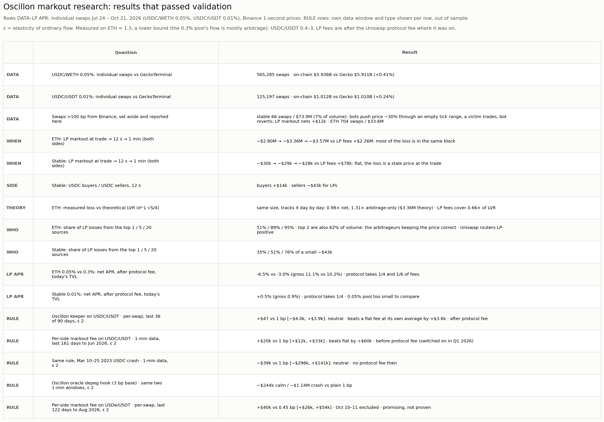
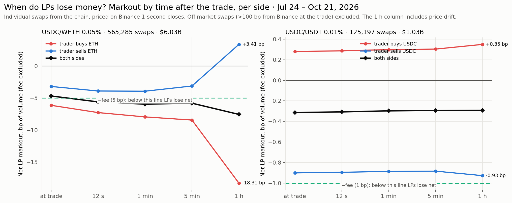
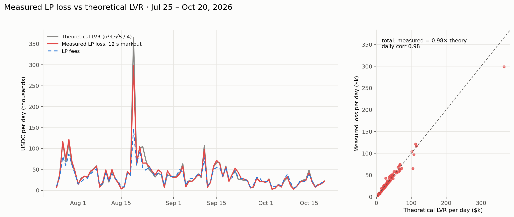
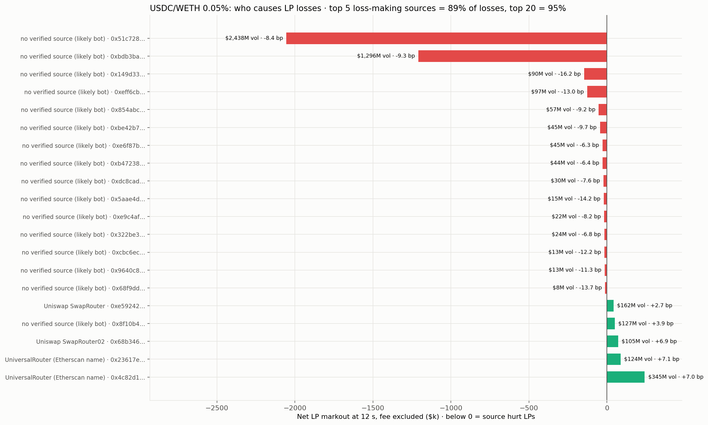
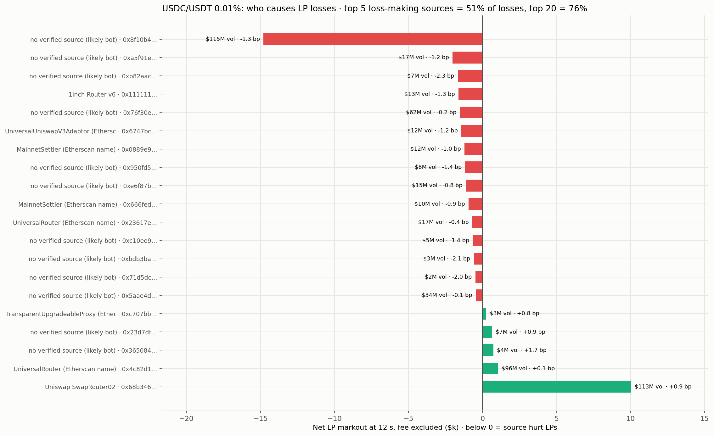

# Oscillon markout research: validated results

*For the Head of LP. Only results that passed validation are here; everything else is listed at the end with the reason it was left out.*

**The product tested:** a keeper measures markout separately for each side of the pool, and sets that side's fee to `pool fee + κ × max(0, measured loss)`, hard-capped at 100 bp. No oracle.

## How these results were validated

1. **Real trades, checked against an independent source.** 690,482 individual swaps pulled straight from the chain (Jul 24 – Oct 21, 2026). Totals agree with GeckoTerminal within 0.24% (USDC/USDT 0.01%) and 0.41% (USDC/WETH 0.05%).
2. **Real prices.** Every trade is priced against Binance at 1-second resolution.
3. **LP fees after the protocol fee.** Both pools pay ¼ of fees to the Uniswap protocol (`feeProtocol` = 68 in `slot0`). The 0.3% ETH pool pays ⅙. The switch was turned on between Oct 2025 and Jan 2026 for USDC/WETH, and between Jan and Apr 2026 for USDC/USDT. Every LP figure for the 90-day window counts only the LPs' 75%.
4. **Off-market swaps set aside, not hidden.**
   - USDC/USDT has 66 swaps worth $73.9M (7% of volume) more than 1% away from Binance. Examined event by event (e.g. [block 25898242](https://etherscan.io/block/25898242)):
     - A bot pushes the price about 30% through a nearly empty price range.
     - A small trader buys at that extreme price (8,782 USDC for 32,342 USDT).
     - The bot swaps back. No liquidity is added or removed in those blocks.
     - LP markout on these 66 swaps is ±$5.9M gross but **nets +$12k**, so they aren't an LP loss.
   - USDC/WETH: 704 swaps, $33.6M.
5. **Fee rules judged only out of sample**, and compared with a flat fee charged at the rule's own average.

## What the results say

**1. On ETH, LP losses happen inside the block, and they match theory in size.**
- **USDC/WETH 0.05%:** LPs lost $3.36M to traders within 12 seconds of their trades, against $2.26M of fees they actually kept.
- **83% of that loss is already there at the moment of the trade.** The pool's price lags Binance, and someone trades the gap.
- **Measured loss is the same size as theoretical LVR (Milionis et al.) and tracks it day by day:** 0.98× net of gains from good flow, 1.31× counting arbitrage losses only.
- **LP fees cover 0.66× of LVR.** Net LP return was about **−6.5% a year** on today's TVL (gross 11.1%). In the 0.3% pool: −3.0%.

**2. On ETH, a few sources cause almost all of it, and they're also most of the volume.**
- **Top source:** 51% of LP losses. **Top 5:** 89%.
- **The top 2 are also 62% of the pool's volume.** They're the arbitrageurs keeping the pool's price in line with the market. The keeper charges them more only while they're costing LPs money; it doesn't target most of the volume all the time.
- **Uniswap's own routers are good flow:** +7 bp for LPs.

**3. On USDC/USDT, there is little to defend in a normal market.**
- **Net loss to informed traders over 90 days was $29k**, against $78k of fees LPs kept. LPs earned about +0.5% a year on today's TVL (gross 0.9%).
- **Traders selling USDC cost LPs $43k; traders buying USDC earned LPs $14k.**
- **The loss doesn't grow after the trade.** It comes from a slightly stale pool price at that moment.

**4. Elasticity, measured rather than assumed.**
- **ETH: about 1.3.** The 0.3% pool took 8.5% of volume against the 0.05% pool despite a 6× fee. That pool's volume is mostly arbitrage, so ordinary flow likely leaves faster than 1.3 suggests; treat it as a lower bound.
- **USDC/USDT: between 0.4 and 3**, from the 0.01% vs 0.05% pools.

**5. Fee rules.** Each states its own data window.
- **The Oscillon keeper on USDC/USDT** (individual swaps, last 36 of 90 days, after protocol fee):

  | Elasticity | Keeper vs plain 1 bp | vs flat fee at its own average |
  |---|---|---|
  | 0.5 | +$23.9k [+$16.0k, +$33.3k] | +$7.3k |
  | **2** | **+$47 [−$4.0k, +$3.9k]: neutral** | +$3.6k |
  | 3 | −$3.1k [−$8.4k, +$1.5k] | +$2.8k |

  At realistic elasticity it neither gains nor loses against plain 1 bp, but it consistently beats a flat fee at the same average. Its timing works; on this pool, in these 36 days, there wasn't much to recover.
- **Per-side markout fee on USDC/USDT, 1-minute data, last 161 days to Jun 2026, elasticity 2:** +$20k (range +$12k to +$33k), beating its flat control by $60k. This is before the protocol fee, which was switched on during that window, and on coarser data than the row above.
- **Same rule in the Mar 10–25, 2023 USDC crash (1-minute data):** neutral, −$39k (range −$296k to +$141k).
- **The original Oscillon oracle depeg hook (3 bp base) lost to plain 1 bp:** −$244k in the calm year and −$1.14M in the crash.
  - It charges only USDC sellers, and the oracle can't tell a falling price from a recovering one.
- **Per-side markout fee on USDe/USDT** (individual swaps, last 122 days to Aug 2026, elasticity 2): +$40k (range +$26k to +$54k), with Oct 10–11 excluded as a Binance price dislocation. **Promising, not proven.**

## Left out on purpose

| Result | Why it isn't here |
|---|---|
| Keeper gains on ETH/USDC | The backtest assumes an arbitrage blocked by a higher fee disappears. On ETH the pool's price stays stale and the arbitrage happens later, so gains are overstated. Needs a price-path simulation first |
| Mar 2023 dollar split by direction | Built from one-minute totals, where same-minute round trips inflate both sides |
| Cross-pair dollar comparisons (USDS, PYUSD, FRAX, AUSD) | No fast market price for those pairs; measured only against each pool's own later price |
| Whole-year fee-rule figures | They include the days the rules were fitted on |
| USDC/USDT 0.01% vs 0.05% APR comparison | The 0.05% pool is too small (3,282 swaps, $0.5M TVL) |

## Limits that still apply

- **APRs use today's TVL from GeckoTerminal**, because historical TVL isn't available on the free API.
- **The keeper's per-swap USDC/USDT test covers only 36 out-of-sample days.** A longer per-swap window is the next check.
- **Flow sources are the contracts that called the pool** (routers, aggregators, bots). The signing wallets weren't pulled: the Dune key hit its billing-cycle limit.

## Reproduce

All numbers come from the `validated-v1` tag. Rebuild the page with `python3 validated_summary.py --png charts_flow/V1_validated_results.png`.
